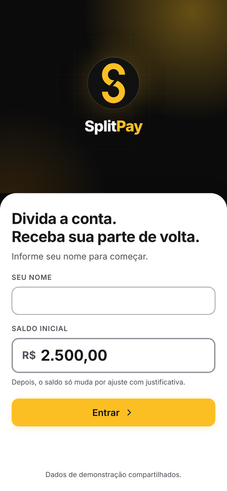
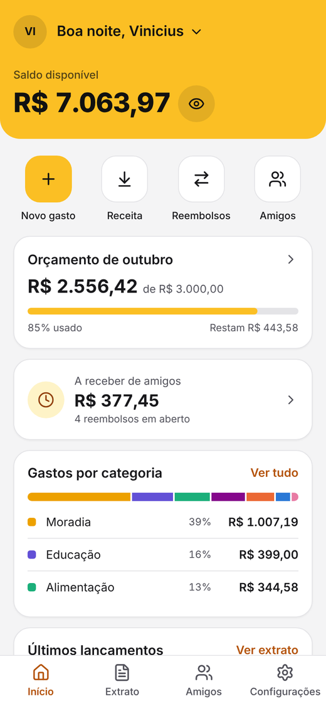
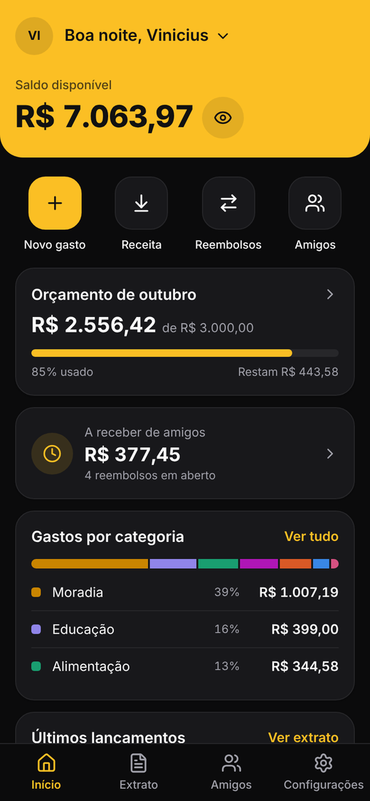
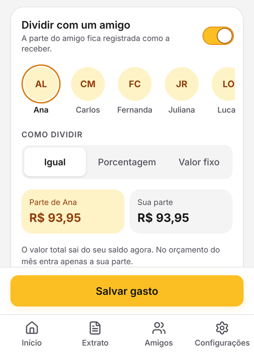
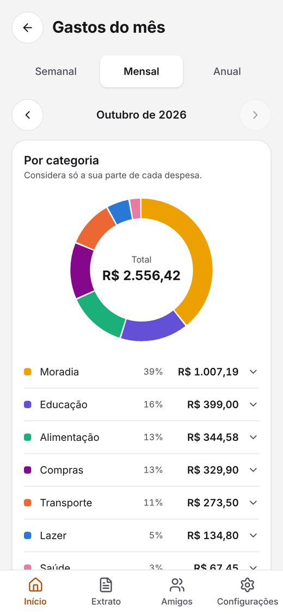
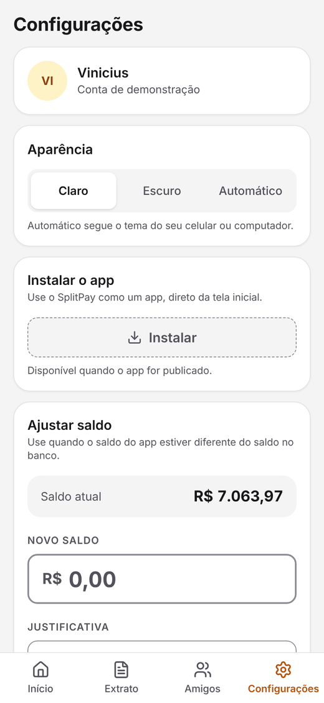
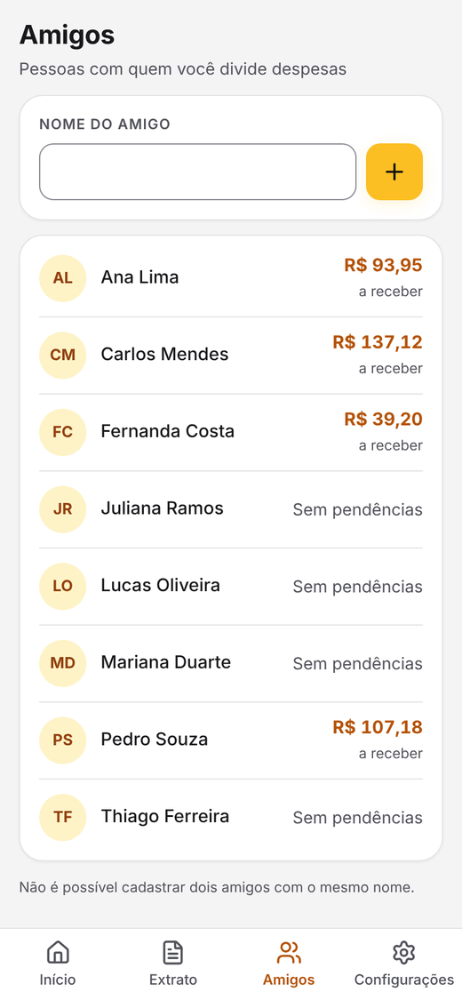
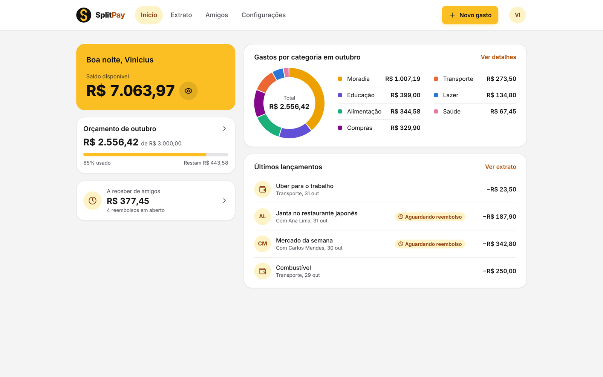
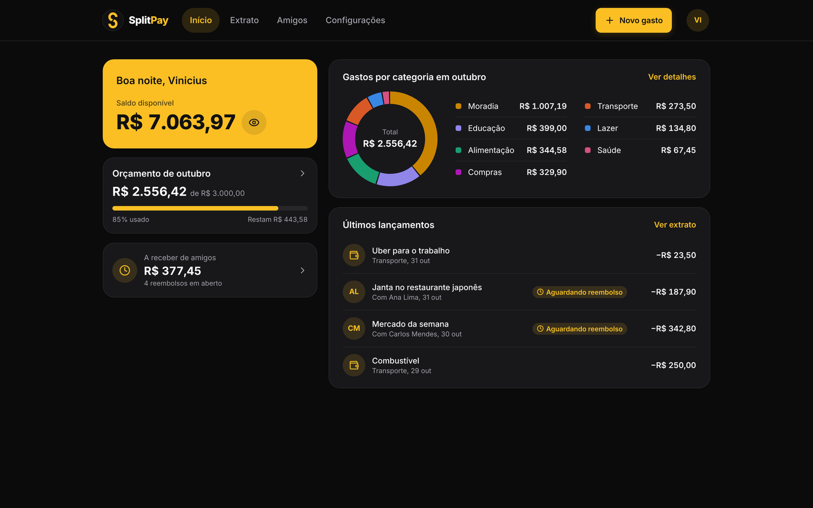
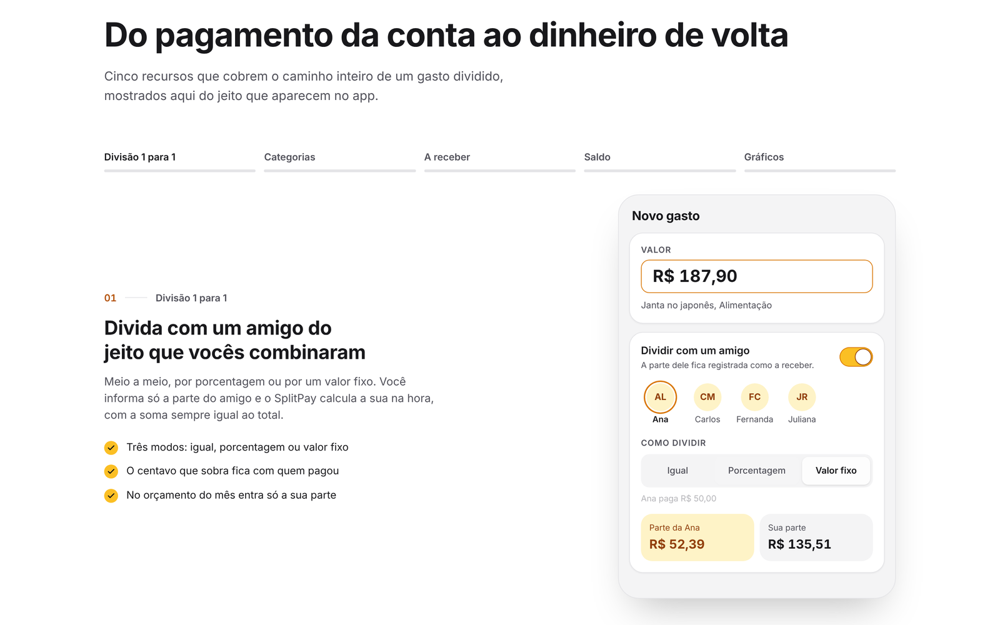

# SplitPay

SplitPay é o app que divide despesas e mostra o seu dinheiro. Registre gastos compartilhados, saiba exatamente quanto você tem a receber e acompanhe seu saldo em tempo real, considerando o que você pagou e o que já foi reembolsado.

<p align="center">
  
</p>

## 🎯 Problema

Dividir contas parece simples, mas logo vira confusão. Quem pagou? Quanto cada um
deve? O dinheiro já voltou?

No fim, são conversas perdidas no WhatsApp, planilhas improvisadas e contas feitas de cabeça.

Os apps do banco mostram só o valor que saiu da sua conta. Eles não sabem que metade daquela janta era de outra pessoa. Por isso seu orçamento parece estourado e seu saldo nunca conta a história completa.

## 💡 Solução

O SplitPay junta saldo, gastos, divisões e reembolsos em um só lugar. Ao registrar uma despesa, o usuário marca com quem dividiu e escolhe como dividir. A parte do amigo vira um valor **a receber**, com status próprio, e só entra no saldo quando o dinheiro volta de verdade.

Três ideias guiam o produto:

- **Cada centavo no lugar certo.** Todo valor é guardado em centavos inteiros, do banco de dados até a tela. Uma conta de R$ 100,00 dividida ao meio vira R$ 50,00 para o amigo e R$ 50,00 para você, e a soma sempre fecha.
- **Categorias que seguem as suas palavras.** Ao digitar "Janta", o gasto vai para Alimentação. Quando uma palavra é só sua, você cria uma regra e ela passa na frente das regras padrão.
- **Um saldo que você consegue explicar.** Saldo inicial, mais entradas, menos saídas, mais ajustes. Todo ajuste manual pede um motivo e fica no histórico com o saldo de antes e o de depois.

> Este MVP trabalha com divisão **1 para 1**: o usuário paga e divide com exatamente um amigo. Divisão em grupo é o próximo passo do roadmap.

## 🖥️ Demonstração

A aplicação ainda não está publicada. Para rodar na sua máquina, veja [Como rodar](#-como-rodar). As capturas abaixo foram feitas a partir do app rodando localmente, com os dados de demonstração.

### 🚪 Entrada

<p align="center">
  
</p>

A entrada pede só o nome e mostra o saldo inicial, que pode ser alterado. Não existe senha: é uma demonstração, e todos os visitantes compartilham os mesmos dados.

### 🏠 Início

<p align="center">
  
  &nbsp;
  
</p>

Saldo disponível, orçamento do mês, quanto falta receber dos amigos, gastos por categoria e os últimos lançamentos, tudo na primeira tela. O olho ao lado do saldo esconde todos os valores, e o app tem tema claro, escuro e automático.

### ➗ Novo gasto com divisão

<p align="center">
  
</p>

O usuário escolhe o amigo e o modo de divisão: **igual**, **porcentagem** ou **valor fixo**. Ele informa só a parte do amigo, e o SplitPay calcula a dele. No orçamento do mês entra apenas a parte do próprio usuário.

### 🧾 Extrato e reembolsos

<p align="center">
  
</p>

Cada parte de amigo aparece como **Aguardando reembolso**. Quando ele devolve, o usuário marca **Recebi** e o valor volta para o saldo. Se acertaram de outro jeito, **Já acertamos** encerra a dívida sem mexer no saldo. Os filtros por status deixam ver só o que importa.

### 📊 Gastos do mês

<p align="center">
  
</p>

Gráficos por categoria e por amigo, com filtro por semana, mês ou ano e navegação entre períodos. Ao tocar em uma categoria, os lançamentos que formam aquele valor aparecem logo abaixo.

### ⚙️ Configurações e amigos

<p align="center">
  
  &nbsp;
  
</p>

Em Configurações ficam a aparência, o ajuste de saldo com justificativa e histórico, o orçamento e as regras de categoria. Em Amigos, o usuário cadastra novas pessoas e vê quanto cada uma ainda deve.

### 💻 No computador

<p align="center">
  
</p>

<p align="center">
  
</p>

O layout é pensado primeiro para o celular e se reorganiza em colunas no computador, com navegação no topo e um menu no avatar para trocar de usuário ou voltar à página inicial.

### ✨ Página de apresentação

<p align="center">
  
</p>

A página inicial apresenta o produto com animações em GSAP. Um tour fixa a tela do app enquanto o visitante rola e troca de funcionalidade a cada passo. Depois vêm os diferenciais e a proposta de startup. Para quem prefere menos movimento no sistema, tudo aparece pronto, sem animação.

## ⚙️ Funcionalidades

- **Divisão 1 para 1:** três modos (igual, porcentagem e valor fixo). O centavo que sobra fica com quem pagou, então as partes sempre somam o total.
- **Reembolsos com status:** Aguardando reembolso, Pago e Acertado. Só o que foi pago de verdade entra no saldo.
- **Categorias automáticas:** 31 regras padrão por palavra-chave, mais regras do próprio usuário, que têm prioridade. A comparação é por palavra inteira, então "bar" não confunde com "Barbearia".
- **Saldo explicável:** saldo inicial, entradas, saídas e ajustes manuais com motivo obrigatório e histórico.
- **Orçamento do mês:** conta apenas a parte do usuário em cada gasto dividido.
- **Gráficos por período:** por categoria e por amigo, por semana, mês ou ano, com o estado "Nenhum dado encontrado" para períodos vazios.
- **Detalhe do lançamento:** local, parcela, forma de pagamento, observações e o amigo envolvido.
- **Receitas:** entradas de dinheiro no mesmo formulário do gasto.
- **Esconder valores:** um toque mascara todos os valores da tela.
- **Temas claro, escuro e automático**, com contraste dentro do padrão WCAG AA.
- **Visual de app instalável:** manifesto e ícones de PWA. A instalação fica disponível quando o app for publicado.

## 🧠 Como funciona a divisão

| Modo | O que o usuário informa | Parte do amigo | Parte do usuário |
|---|---|---|---|
| Igual | Nada além do total | metade do total, arredondada para baixo | total menos a parte do amigo |
| Porcentagem | A porcentagem do amigo (0 a 100) | total vezes a porcentagem, arredondado para baixo | total menos a parte do amigo |
| Valor fixo | O valor do amigo | o valor informado | total menos a parte do amigo |

O saldo segue uma fórmula única:

```text
saldo = saldo inicial + entradas - saídas + ajustes
```

Entradas são as receitas e os reembolsos marcados como **Pago**. O saldo nunca é gravado como um número solto: ele é sempre recalculado a partir dos lançamentos.

## 🔨 Stack

| Camada | Tecnologia | Por quê |
|---|---|---|
| API | Python 3.12+, FastAPI, Pydantic | API REST real com validação automática e documentação Swagger em `/docs`. |
| Banco | SQLite com SQL puro, sem ORM | Modelagem relacional com chaves, restrições e consultas legíveis, sem infraestrutura extra. |
| Frontend | React 18, TypeScript, Vite | Tipagem estrita pega erros de contrato com a API antes de chegar na tela. |
| Estilo | Tailwind CSS 4, Inter, Lucide | Layout mobile first com tokens de tema para claro e escuro. |
| Animação | GSAP 3 e ScrollTrigger | Usado apenas na página inicial, que carrega separada do app. |
| Testes | Pytest e TestClient | 807 testes cobrindo regras de negócio, validação e consistência dos dados. |

O banco é recriado a partir dos dados de demonstração toda vez que a API inicia. Assim a apresentação sempre começa do mesmo ponto.

## 🚀 Como rodar

Pré-requisitos: Python 3.12 ou mais novo e Node.js.

```bash
python3 run.py
```

Na primeira execução o script cria o ambiente virtual em `backend/.venv`, instala o `requirements.txt` e roda o `npm install`. Depois ele sobe:

- a API em http://localhost:8000 (documentação em http://localhost:8000/docs)
- o app em http://localhost:5173

Para subir só uma das partes, use `python3 run.py api` ou `python3 run.py web`. Ctrl+C encerra tudo.

<details>
<summary>Passo a passo manual</summary>

```bash
# API
cd backend
python3.12 -m venv .venv
source .venv/bin/activate
pip install -r requirements.txt
cp .env.example .env
uvicorn app.main:app --reload --env-file .env
pytest

# App
cd frontend
npm install
cp .env.example .env
npm run dev
npm run build
```

</details>

## 📂 Estrutura do projeto

```text
.
├── backend/            # API FastAPI
│   ├── app/
│   │   ├── routers/    # Rotas por recurso (saldo, transações, reembolsos e categorias)
│   │   ├── services/   # Regras de negócio
│   │   └── schemas/    # Contratos de entrada e saída
│   ├── sql/            # Esquema e dados de demonstração
│   └── tests/          # Testes automatizados
├── frontend/           # App React + TypeScript
│   └── src/
│       ├── app/        # Telas, componentes e página inicial
│       ├── lib/        # Dinheiro, datas, texto e preferências
│       └── services/   # Cliente tipado da API
├── docs/               # Documentos
└── run.py              # Sobe API e app com um comando
```

## 🗺️ Próximos passos

- Publicar o app na Vercel e a API no Render.
- Divisão em grupo, com mais de um amigo por gasto.
- Integração com Pix para cobrar e receber a parte de cada um.
- Open Finance para importar lançamentos do banco.

## 🎓 Contexto

Projeto desenvolvido na FIAP, como MVP de uma fintech de finanças pessoais com foco em despesas compartilhadas.

## 📝 Licença

Este projeto está sob a licença MIT. Veja o arquivo [LICENSE](LICENSE) para mais detalhes. Créditos de terceiros estão em [ATTRIBUTIONS.md](ATTRIBUTIONS.md).
